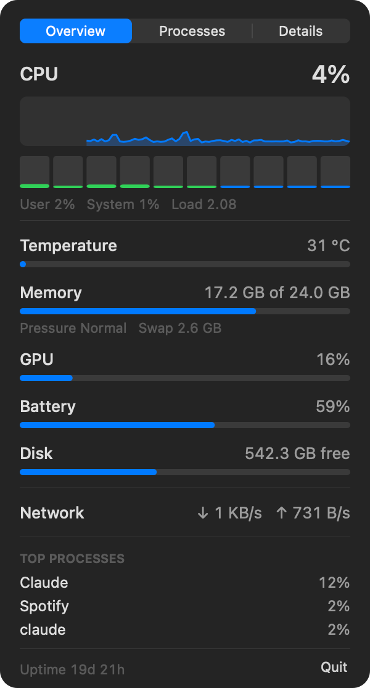
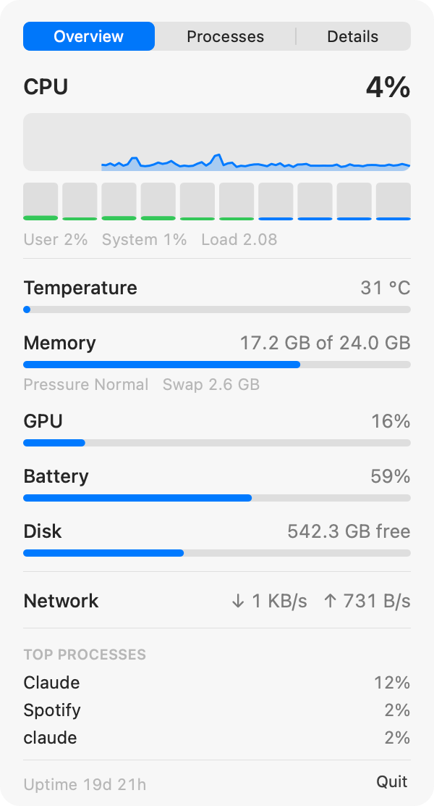
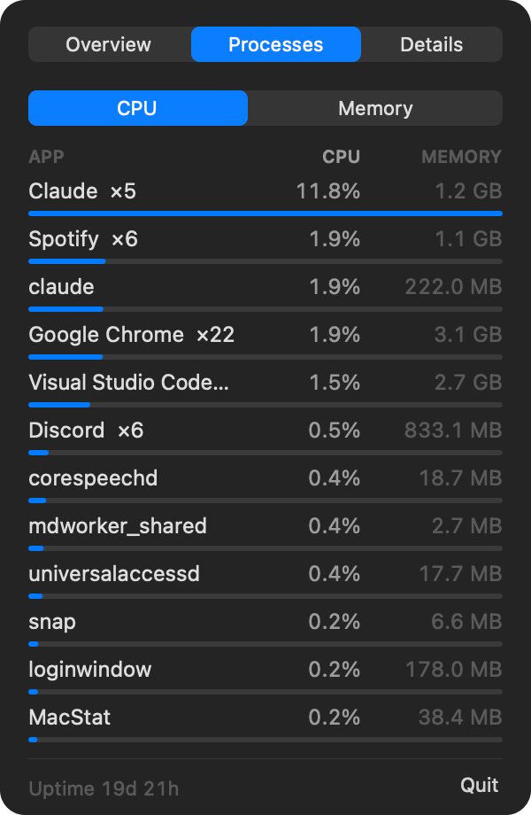
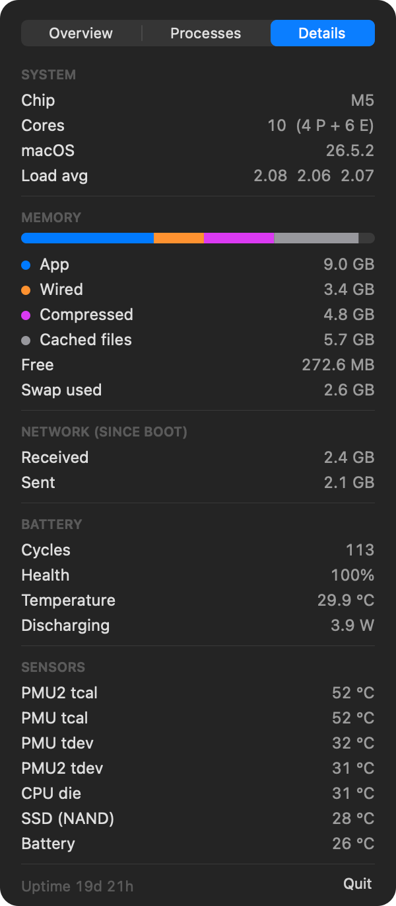

# MacStat

A tiny native system monitor that lives in the macOS menu bar.
Click it to see CPU, memory, temperature, GPU, battery, disk, network and the apps using the most resources.

- **Tiny:** one ~150 KB binary, pure AppKit, no dependencies (the whole `.app` is ~0.5 MB including the icon).
- **Light on energy:** with the panel closed it wakes up every 2 s and reads only CPU and temperature. Everything else is sampled only while the panel is open.
- **Native look:** system fonts and colors, light and dark mode.

<p align="center">
  
  
</p>

## Features

| Tab | What you get |
| --- | --- |
| **Overview** | CPU load with history graph and per-core bars (E-cores green), temperature, memory and pressure, GPU, battery, disk, network speed, top 3 processes |
| **Processes** | Top 12 apps by CPU or memory, grouped per app (e.g. "Google Chrome ×22") |
| **Details** | Chip and cores, load average, memory breakdown (App / Wired / Compressed / Cached), network totals, battery cycles / health / power, all temperature sensors |

<p align="center">
  
  
</p>

The menu bar shows CPU load and temperature (e.g. `8% 29°`). Right-click the item for Quit.

## Requirements

- Apple Silicon Mac, macOS 13+
- Xcode Command Line Tools (`xcode-select --install`) to build

Temperature is read from Apple Silicon HID sensors (a private API), so Intel Macs are not supported.

## Build

```bash
./build.sh
open build/MacStat.app
```

Drag `build/MacStat.app` to `/Applications` and add it to *System Settings → General → Login Items* to start at login.
The app is ad-hoc signed; if Gatekeeper complains, right-click → Open.

## Project layout

- `Sources/main.swift` — the whole app
- `tools/MakeIcon.swift` — generates `Resources/AppIcon.icns`
- `build.sh` — builds the `.app` bundle
- Debug screenshots: `swiftc -D SNAPSHOT Sources/main.swift -o snap && ./snap` renders the panel to `docs/screenshots/`

## License

[MIT](LICENSE)
